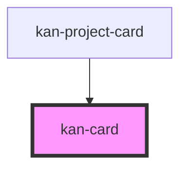

# kan-card

<!-- Auto Generated Below -->

## Overview

A container on bg.surface with optional header and footer (KIT-004). With an href, the whole
card is clickable through one link around the header, stretched over the card, so links in the
footer stay separate and links are never nested.

## Properties

| Property | Attribute | Description                                  | Type                  | Default     |
| -------- | --------- | -------------------------------------------- | --------------------- | ----------- |
| `href`   | `href`    | Makes the whole card a link to this address. | `string \| undefined` | `undefined` |

## Slots

| Slot       | Description                                         |
| ---------- | --------------------------------------------------- |
|            | The body.                                           |
| `"footer"` | Actions or metadata at the bottom.                  |
| `"header"` | The heading; with an href, this is the link's text. |

## Shadow Parts

| Part       | Description                               |
| ---------- | ----------------------------------------- |
| `"body"`   | The body.                                 |
| `"card"`   | The card.                                 |
| `"footer"` | The footer.                               |
| `"header"` | The header.                               |
| `"link"`   | The stretched link, when there's an href. |

## Dependencies

### Used by

 - [kan-project-card](../kan-project-card)

### Graph

----------------------------------------------

*Built with [StencilJS](https://stenciljs.com/)*
