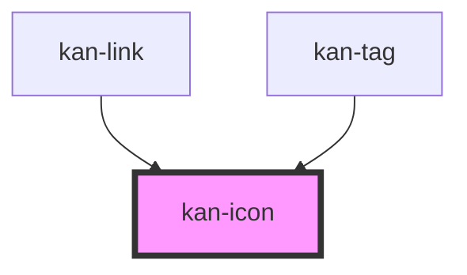

# kan-icon

<!-- Auto Generated Below -->

## Overview

An icon from the kan- set (KIT-012). Decorative by default and hidden from assistive tech;
give it a label and it's announced as an image instead.

## Properties

| Property | Attribute | Description                                                                        | Type                                                                                                                | Default      |
| -------- | --------- | ---------------------------------------------------------------------------------- | ------------------------------------------------------------------------------------------------------------------- | ------------ |
| `label`  | `label`   | What the icon means, for screen readers. Leave it out when the icon is decoration. | `string \| undefined`                                                                                               | `undefined`  |
| `name`   | `name`    | Which icon to draw.                                                                | `"close" \| "external" \| "github" \| "linkedin" \| "mail" \| "menu" \| "monitor" \| "moon" \| "sun" \| "terminal"` | `"terminal"` |

## Shadow Parts

| Part    | Description |
| ------- | ----------- |
| `"svg"` | The SVG.    |

## Dependencies

### Used by

 - [kan-link](../kan-link)
 - [kan-tag](../kan-tag)

### Graph

----------------------------------------------

*Built with [StencilJS](https://stenciljs.com/)*
