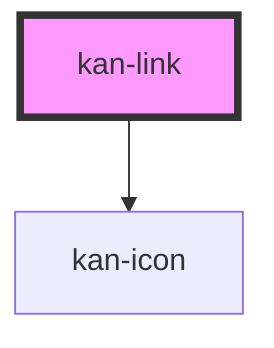

# kan-link

<!-- Auto Generated Below -->

## Overview

A link (KIT-002): a native anchor in the accent color, underlined, and more so on hover and
focus. A link that opens a new tab says so, with an icon and a hint for screen readers, and
gets rel="noopener noreferrer".

## Properties

| Property | Attribute | Description                                 | Type                  | Default     |
| -------- | --------- | ------------------------------------------- | --------------------- | ----------- |
| `href`   | `href`    | Where the link goes.                        | `string`              | `""`        |
| `target` | `target`  | Where to open it. "_blank" opens a new tab. | `string \| undefined` | `undefined` |

## Slots

| Slot | Description    |
| ---- | -------------- |
|      | The link text. |

## Shadow Parts

| Part     | Description |
| -------- | ----------- |
| `"link"` | The anchor. |

## Dependencies

### Depends on

- [kan-icon](../kan-icon)

### Graph

----------------------------------------------

*Built with [StencilJS](https://stenciljs.com/)*
