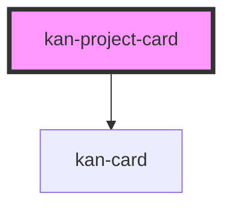

# kan-project-card

<!-- Auto Generated Below -->

## Overview

A project (KIT-005): its name, a one-line summary, its stack as tags, and links to the source
and, when there is one, a live demo. It's a kan-card; put kan-tag elements in the stack slot and
kan-link elements in the links slot.

## Properties

| Property | Attribute | Description         | Type     | Default |
| -------- | --------- | ------------------- | -------- | ------- |
| `name`   | `name`    | The project's name. | `string` | `""`    |

## Slots

| Slot      | Description                                                       |
| --------- | ----------------------------------------------------------------- |
|           | The one-line summary.                                             |
| `"links"` | kan-link elements: the source, and a live demo when there is one. |
| `"stack"` | kan-tag elements, one per technology.                             |

## Shadow Parts

| Part        | Description         |
| ----------- | ------------------- |
| `"links"`   | The links.          |
| `"name"`    | The project's name. |
| `"stack"`   | The stack tags.     |
| `"summary"` | The summary.        |

## Dependencies

### Depends on

- [kan-card](../kan-card)

### Graph

----------------------------------------------

*Built with [StencilJS](https://stenciljs.com/)*
