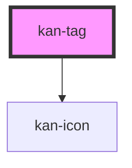

# kan-tag

<!-- Auto Generated Below -->

## Overview

A short mono label, like a technology name (KIT-003). It isn't interactive.

## Properties

| Property | Attribute | Description               | Type                                                                                                                             | Default     |
| -------- | --------- | ------------------------- | -------------------------------------------------------------------------------------------------------------------------------- | ----------- |
| `icon`   | `icon`    | An icon before the label. | `"close" \| "external" \| "github" \| "linkedin" \| "mail" \| "menu" \| "monitor" \| "moon" \| "sun" \| "terminal" \| undefined` | `undefined` |

## Slots

| Slot | Description |
| ---- | ----------- |
|      | The label.  |

## Shadow Parts

| Part     | Description                |
| -------- | -------------------------- |
| `"icon"` | The optional leading icon. |
| `"tag"`  | The tag.                   |

## Dependencies

### Depends on

- [kan-icon](../kan-icon)

### Graph

----------------------------------------------

*Built with [StencilJS](https://stenciljs.com/)*
