# Spec graph

Generated by `bun run specs:graph`; do not edit by hand. 10 intents, 14 journeys, 135 behaviors.

## Intents and journeys

```mermaid
flowchart LR
  INT_001["INT-001<br/>A visitor knows who Ian is and what Ian builds within seconds, and can get in touch"]:::intent
  INT_002["INT-002<br/>The site has a recognizable agentic identity that is the same everywhere"]:::intent
  INT_003["INT-003<br/>How the site is built is itself proof of Ian's skill"]:::intent
  INT_004["INT-004<br/>The site is comfortable for everyone, on any device and in either theme"]:::intent
  INT_005["INT-005<br/>The site is fast and private"]:::intent
  INT_006["INT-006<br/>Changing the look is an edit in one place, and mistakes are caught"]:::intent
  INT_007["INT-007<br/>Keeping the site current is cheap"]:::intent
  INT_008["INT-008<br/>Features are added by talking to an agent, guided by the spec graph"]:::intent
  INT_009["INT-009<br/>Agents can read the site as well as people can"]:::intent
  INT_010["INT-010<br/>Agent output is trusted because gates enforce the rules"]:::intent
  JRN_001("JRN-001<br/>A recruiter scans the home page and reaches out"):::journey
  JRN_002("JRN-002<br/>An engineer digs into the work"):::journey
  JRN_003("JRN-003<br/>A visitor reads in their preferred theme"):::journey
  JRN_004("JRN-004<br/>A visitor uses a keyboard, a screen reader, reduced motion or no JavaScript"):::journey
  JRN_005("JRN-005<br/>A visitor arrives from a shared link or a search"):::journey
  JRN_006("JRN-006<br/>Ian restyles the identity"):::journey
  JRN_007("JRN-007<br/>Ian builds a new component"):::journey
  JRN_008("JRN-008<br/>Ian adds a project or updates the content"):::journey
  JRN_009("JRN-009<br/>Ian ships a change"):::journey
  JRN_010("JRN-010<br/>Ian asks an agent to add a feature"):::journey
  JRN_011("JRN-011<br/>Someone visits Ian's GitHub profile"):::journey
  JRN_012("JRN-012<br/>A visitor's AI assistant researches Ian"):::journey
  JRN_013("JRN-013<br/>An engineer sees how the site was built"):::journey
  JRN_014("JRN-014<br/>An agent delivers a feature through the gates"):::journey
  JRN_001 --> INT_001
  JRN_001 --> INT_004
  JRN_002 --> INT_003
  JRN_002 --> INT_002
  JRN_003 --> INT_004
  JRN_003 --> INT_002
  JRN_004 --> INT_004
  JRN_005 --> INT_001
  JRN_005 --> INT_005
  JRN_006 --> INT_006
  JRN_006 --> INT_002
  JRN_007 --> INT_003
  JRN_007 --> INT_006
  JRN_008 --> INT_007
  JRN_008 --> INT_001
  JRN_009 --> INT_007
  JRN_009 --> INT_005
  JRN_010 --> INT_008
  JRN_011 --> INT_001
  JRN_011 --> INT_002
  JRN_012 --> INT_009
  JRN_012 --> INT_001
  JRN_013 --> INT_003
  JRN_013 --> INT_008
  JRN_014 --> INT_010
  JRN_014 --> INT_008
  classDef intent fill:#083344,stroke:#22d3ee,color:#ecfeff
  classDef journey fill:#111827,stroke:#6b7280,color:#f9fafb
```

## Intents

| Intent | Journeys |
|---|---|
| [INT-001](intents/INT-001-know-ian-fast.md) A visitor knows who Ian is and what Ian builds within seconds, and can get in touch | [JRN-001](journeys/JRN-001-recruiter-scans-and-reaches-out.md), [JRN-005](journeys/JRN-005-arrives-from-a-shared-link.md), [JRN-008](journeys/JRN-008-ian-updates-content.md), [JRN-011](journeys/JRN-011-github-profile-visit.md), [JRN-012](journeys/JRN-012-assistant-researches-ian.md) |
| [INT-002](intents/INT-002-recognizable-identity.md) The site has a recognizable agentic identity that is the same everywhere | [JRN-002](journeys/JRN-002-engineer-digs-in.md), [JRN-003](journeys/JRN-003-reads-in-preferred-theme.md), [JRN-006](journeys/JRN-006-ian-restyles-the-identity.md), [JRN-011](journeys/JRN-011-github-profile-visit.md) |
| [INT-003](intents/INT-003-system-is-proof.md) How the site is built is itself proof of Ian's skill | [JRN-002](journeys/JRN-002-engineer-digs-in.md), [JRN-007](journeys/JRN-007-ian-builds-a-component.md), [JRN-013](journeys/JRN-013-engineer-sees-how-it-was-built.md) |
| [INT-004](intents/INT-004-comfortable-for-everyone.md) The site is comfortable for everyone, on any device and in either theme | [JRN-001](journeys/JRN-001-recruiter-scans-and-reaches-out.md), [JRN-003](journeys/JRN-003-reads-in-preferred-theme.md), [JRN-004](journeys/JRN-004-assistive-tech-and-preferences.md) |
| [INT-005](intents/INT-005-fast-and-private.md) The site is fast and private | [JRN-005](journeys/JRN-005-arrives-from-a-shared-link.md), [JRN-009](journeys/JRN-009-ian-ships-a-change.md) |
| [INT-006](intents/INT-006-restyle-in-one-place.md) Changing the look is an edit in one place, and mistakes are caught | [JRN-006](journeys/JRN-006-ian-restyles-the-identity.md), [JRN-007](journeys/JRN-007-ian-builds-a-component.md) |
| [INT-007](intents/INT-007-cheap-to-keep-current.md) Keeping the site current is cheap | [JRN-008](journeys/JRN-008-ian-updates-content.md), [JRN-009](journeys/JRN-009-ian-ships-a-change.md) |
| [INT-008](intents/INT-008-features-by-conversation.md) Features are added by talking to an agent, guided by the spec graph | [JRN-010](journeys/JRN-010-agent-adds-a-feature.md), [JRN-013](journeys/JRN-013-engineer-sees-how-it-was-built.md), [JRN-014](journeys/JRN-014-agent-delivers-through-the-gates.md) |
| [INT-009](intents/INT-009-readable-by-agents.md) Agents can read the site as well as people can | [JRN-012](journeys/JRN-012-assistant-researches-ian.md) |
| [INT-010](intents/INT-010-trusted-through-gates.md) Agent output is trusted because gates enforce the rules | [JRN-014](journeys/JRN-014-agent-delivers-through-the-gates.md) |

## Journeys

### JRN-001 · A recruiter scans the home page and reaches out

[journeys/JRN-001-recruiter-scans-and-reaches-out.md](journeys/JRN-001-recruiter-scans-and-reaches-out.md) · **Actor:** A recruiter or hiring manager on a phone, with a minute to spare · **Serves:** [INT-001](intents/INT-001-know-ian-fast.md), [INT-004](intents/INT-004-comfortable-for-everyone.md)

| # | Step | Behaviors |
|---|---|---|
| 1 | Opens the home page from a link | [SITE-001](features/site.feature#L8) The first screen says who and what [SITE-013](features/site.feature#L71) The home page reads like an agent session [SITE-012](features/site.feature#L67) Responsive from phone to wide desktop [KIT-010](features/kit.feature#L58) kan-site-header [KIT-007](features/kit.feature#L41) kan-prompt [KIT-013](features/kit.feature#L72) kan-tool-call [KIT-012](features/kit.feature#L67) kan-icon |
| 2 | Scans the tech stack | [SITE-003](features/site.feature#L19) The tech stack, grouped [KIT-003](features/kit.feature#L19) kan-tag [KIT-006](features/kit.feature#L35) kan-section-heading |
| 3 | Skims the featured projects | [SITE-002](features/site.feature#L13) Featured projects [KIT-005](features/kit.feature#L29) kan-project-card [KIT-004](features/kit.feature#L24) kan-card |
| 4 | Reads a little about Ian | [SITE-004](features/site.feature#L24) About [KIT-008](features/kit.feature#L47) kan-terminal [KIT-014](features/kit.feature#L78) kan-plan |
| 5 | Gets in touch | [SITE-005](features/site.feature#L29) Contact without a backend [SITE-015](features/site.feature#L77) Resume download [KIT-011](features/kit.feature#L63) kan-site-footer [KIT-002](features/kit.feature#L14) kan-link |

### JRN-002 · An engineer digs into the work

[journeys/JRN-002-engineer-digs-in.md](journeys/JRN-002-engineer-digs-in.md) · **Actor:** A frontend or design-systems engineer, often an interviewer · **Serves:** [INT-003](intents/INT-003-system-is-proof.md), [INT-002](intents/INT-002-recognizable-identity.md)

| # | Step | Behaviors |
|---|---|---|
| 1 | Opens a project's source or live demo | [SITE-002](features/site.feature#L13) Featured projects [KIT-002](features/kit.feature#L14) kan-link |
| 2 | Follows the footer link to the Storybook | [KIT-011](features/kit.feature#L63) kan-site-footer [SHIP-005](features/ship.feature#L31) Deploy on merge [DOCS-006](features/storybook.feature#L32) An introduction to the system |
| 3 | Browses components in light and dark | [DOCS-001](features/storybook.feature#L8) Every variant and state has a story [DOCS-002](features/storybook.feature#L12) Theme switch in the toolbar [DOCS-003](features/storybook.feature#L17) Component docs come from the source [KIT-001](features/kit.feature#L8) kan-button |
| 4 | Inspects the tokens and their contrast | [DOCS-004](features/storybook.feature#L22) Foundations pages show the tokens [DOCS-005](features/storybook.feature#L28) Contrast is visible [PRIM-003](features/primitives.feature#L18) The electric cyan brand ramp [SEM-007](features/semantics.feature#L37) Text meets WCAG AA contrast in both modes |
| 5 | Tries the library on a plain HTML page | [CMP-004](features/components.feature#L22) Works in plain HTML [CMP-001](features/components.feature#L8) One prefix [CMP-003](features/components.feature#L17) Shadow DOM with styling hooks [CMP-007](features/components.feature#L36) A typed, documented API [CMP-008](features/components.feature#L41) Events are namespaced and cross the shadow boundary |

### JRN-003 · A visitor reads in their preferred theme

[journeys/JRN-003-reads-in-preferred-theme.md](journeys/JRN-003-reads-in-preferred-theme.md) · **Actor:** Any visitor · **Serves:** [INT-004](intents/INT-004-comfortable-for-everyone.md), [INT-002](intents/INT-002-recognizable-identity.md)

| # | Step | Behaviors |
|---|---|---|
| 1 | Arrives with a system light or dark setting | [THEME-001](features/theme.feature#L8) Follows the system by default [THEME-004](features/theme.feature#L24) No flash of the wrong theme [TOK-003](features/token-build.feature#L17) Modes in CSS |
| 2 | Switches the theme, and the choice is remembered | [THEME-002](features/theme.feature#L13) The toggle switches and remembers [THEME-003](features/theme.feature#L19) Going back to the system setting [KIT-009](features/kit.feature#L53) kan-theme-toggle [THEME-008](features/theme.feature#L48) Components follow the theme |
| 3 | Their system switches theme while they read | [THEME-005](features/theme.feature#L30) System changes apply live |

### JRN-004 · A visitor uses a keyboard, a screen reader, reduced motion or no JavaScript

[journeys/JRN-004-assistive-tech-and-preferences.md](journeys/JRN-004-assistive-tech-and-preferences.md) · **Actor:** A visitor who relies on assistive tech or has strict browser settings · **Serves:** [INT-004](intents/INT-004-comfortable-for-everyone.md)

| # | Step | Behaviors |
|---|---|---|
| 1 | Skips to the content and moves around by keyboard | [SITE-011](features/site.feature#L61) Landmarks, headings and a skip link [CMP-009](features/components.feature#L46) Keyboard and focus [SEM-011](features/semantics.feature#L59) One focus ring for everything [KIT-010](features/kit.feature#L58) kan-site-header |
| 2 | Listens with a screen reader | [KIT-006](features/kit.feature#L35) kan-section-heading [KIT-012](features/kit.feature#L67) kan-icon [KIT-001](features/kit.feature#L8) kan-button [KIT-013](features/kit.feature#L72) kan-tool-call [KIT-014](features/kit.feature#L78) kan-plan [THEME-006](features/theme.feature#L36) The toggle is accessible [CMP-006](features/components.feature#L31) Content lives in the page |
| 3 | Prefers reduced motion | [SEM-012](features/semantics.feature#L63) Motion turns off for reduced motion [CMP-011](features/components.feature#L56) Reduced motion [KIT-007](features/kit.feature#L41) kan-prompt |
| 4 | Reads with low vision | [SEM-007](features/semantics.feature#L37) Text meets WCAG AA contrast in both modes [SEM-008](features/semantics.feature#L43) UI elements meet non-text contrast in both modes [QUAL-005](features/quality.feature#L27) Every page passes axe [CMP-010](features/components.feature#L52) No accessibility violations |
| 5 | Browses with JavaScript turned off | [SITE-008](features/site.feature#L44) Readable without JavaScript [THEME-007](features/theme.feature#L42) Without JavaScript |

### JRN-005 · A visitor arrives from a shared link or a search

[journeys/JRN-005-arrives-from-a-shared-link.md](journeys/JRN-005-arrives-from-a-shared-link.md) · **Actor:** Someone who saw the link on LinkedIn, in a chat, or in search results · **Serves:** [INT-001](intents/INT-001-know-ian-fast.md), [INT-005](intents/INT-005-fast-and-private.md)

| # | Step | Behaviors |
|---|---|---|
| 1 | Sees a rich preview where the link was shared | [SITE-010](features/site.feature#L56) Shares well |
| 2 | The page loads fast and nothing tracks them | [QUAL-001](features/quality.feature#L8) Lighthouse [QUAL-002](features/quality.feature#L13) JavaScript budget [QUAL-003](features/quality.feature#L18) Fonts [QUAL-004](features/quality.feature#L23) No third-party requests [CMP-005](features/components.feature#L27) Pages download only what they use |
| 3 | Uses whatever browser they have | [QUAL-006](features/quality.feature#L31) Works across browser engines |
| 4 | Follows an old or mistyped link | [SITE-009](features/site.feature#L50) A 404 in the terminal voice |

### JRN-006 · Ian restyles the identity

[journeys/JRN-006-ian-restyles-the-identity.md](journeys/JRN-006-ian-restyles-the-identity.md) · **Actor:** Ian, changing the accent color, type scale or spacing · **Serves:** [INT-006](intents/INT-006-restyle-in-one-place.md), [INT-002](intents/INT-002-recognizable-identity.md)

| # | Step | Behaviors |
|---|---|---|
| 1 | Edits the primitive tokens | [PRIM-001](features/primitives.feature#L8) Tokens are written in DTCG format [PRIM-002](features/primitives.feature#L13) Colors are authored in OKLCH [PRIM-003](features/primitives.feature#L18) The electric cyan brand ramp [PRIM-004](features/primitives.feature#L24) A neutral ramp tinted toward the brand [PRIM-005](features/primitives.feature#L30) Status ramps that can't be mistaken for the accent [PRIM-006](features/primitives.feature#L35) A 4px spacing scale [PRIM-007](features/primitives.feature#L40) Two font families [PRIM-008](features/primitives.feature#L45) A modular type scale [PRIM-009](features/primitives.feature#L52) Shape: small radii and thin borders [PRIM-010](features/primitives.feature#L57) Motion [PRIM-011](features/primitives.feature#L62) Breakpoints |
| 2 | The semantic roles pick up the change | [SEM-001](features/semantics.feature#L8) Semantic tokens only reference primitives [SEM-002](features/semantics.feature#L13) Light and dark define the same tokens [SEM-003](features/semantics.feature#L19) Background roles [SEM-004](features/semantics.feature#L24) Text roles [SEM-005](features/semantics.feature#L28) Border roles [SEM-006](features/semantics.feature#L32) Accent and status roles [SEM-009](features/semantics.feature#L47) Typography roles [SEM-010](features/semantics.feature#L54) Spacing and layout roles |
| 3 | One build regenerates every output | [TOK-001](features/token-build.feature#L8) One build makes every output [TOK-002](features/token-build.feature#L13) Every custom property is prefixed [TOK-004](features/token-build.feature#L23) Semantic properties point at primitives [TOK-005](features/token-build.feature#L27) Typed token names [TOK-008](features/token-build.feature#L44) The build is repeatable |
| 4 | Mistakes are caught before they ship | [TOK-006](features/token-build.feature#L32) Broken references fail the build [TOK-007](features/token-build.feature#L38) Contrast is checked on every build [CMP-002](features/components.feature#L12) Styled only with semantic tokens [SITE-007](features/site.feature#L39) Built only from the design system |
| 5 | Reviews the result in Storybook | [DOCS-004](features/storybook.feature#L22) Foundations pages show the tokens [DOCS-005](features/storybook.feature#L28) Contrast is visible [DOCS-002](features/storybook.feature#L12) Theme switch in the toolbar |

### JRN-007 · Ian builds a new component

[journeys/JRN-007-ian-builds-a-component.md](journeys/JRN-007-ian-builds-a-component.md) · **Actor:** Ian, or an agent working for Ian · **Serves:** [INT-003](intents/INT-003-system-is-proof.md), [INT-006](intents/INT-006-restyle-in-one-place.md)

| # | Step | Behaviors |
|---|---|---|
| 1 | Creates it following the library's conventions | [CMP-001](features/components.feature#L8) One prefix [CMP-002](features/components.feature#L12) Styled only with semantic tokens [CMP-003](features/components.feature#L17) Shadow DOM with styling hooks [CMP-006](features/components.feature#L31) Content lives in the page [CMP-007](features/components.feature#L36) A typed, documented API [CMP-008](features/components.feature#L41) Events are namespaced and cross the shadow boundary [TOK-005](features/token-build.feature#L27) Typed token names |
| 2 | Documents and tests it in Storybook | [DOCS-001](features/storybook.feature#L8) Every variant and state has a story [DOCS-003](features/storybook.feature#L17) Component docs come from the source [DOCS-007](features/storybook.feature#L37) Stories are tested [CMP-010](features/components.feature#L52) No accessibility violations |
| 3 | Uses it on a page | [SITE-007](features/site.feature#L39) Built only from the design system [CMP-005](features/components.feature#L27) Pages download only what they use |

### JRN-008 · Ian adds a project or updates the content

[journeys/JRN-008-ian-updates-content.md](journeys/JRN-008-ian-updates-content.md) · **Actor:** Ian · **Serves:** [INT-007](intents/INT-007-cheap-to-keep-current.md), [INT-001](intents/INT-001-know-ian-fast.md)

| # | Step | Behaviors |
|---|---|---|
| 1 | Adds or edits a content entry | [SITE-006](features/site.feature#L34) Content is data [SITE-002](features/site.feature#L13) Featured projects [SITE-003](features/site.feature#L19) The tech stack, grouped |
| 2 | Previews it locally | [SHIP-002](features/ship.feature#L13) Local development |
| 3 | Merges, and the site deploys | [GATE-002](features/gates.feature#L14) Every pull request runs the gate [SHIP-005](features/ship.feature#L31) Deploy on merge |

### JRN-009 · Ian ships a change

[journeys/JRN-009-ian-ships-a-change.md](journeys/JRN-009-ian-ships-a-change.md) · **Actor:** Ian, or an agent working for Ian · **Serves:** [INT-007](intents/INT-007-cheap-to-keep-current.md), [INT-005](intents/INT-005-fast-and-private.md)

| # | Step | Behaviors |
|---|---|---|
| 1 | Builds everything from a clean checkout | [SHIP-001](features/ship.feature#L8) One install, one build [SHIP-003](features/ship.feature#L19) Bun version is pinned |
| 2 | Opens a pull request and the gate runs | [GATE-001](features/gates.feature#L8) One gate command [GATE-002](features/gates.feature#L14) Every pull request runs the gate [QUAL-001](features/quality.feature#L8) Lighthouse [QUAL-002](features/quality.feature#L13) JavaScript budget [QUAL-006](features/quality.feature#L31) Works across browser engines [DOCS-007](features/storybook.feature#L37) Stories are tested [GRAPH-006](features/graph.feature#L37) Gherkin must parse |
| 3 | Merges, and the site and Storybook deploy | [SHIP-005](features/ship.feature#L31) Deploy on merge [SHIP-006](features/ship.feature#L37) Served at www.iankaneshiro.dev [SHIP-008](features/ship.feature#L42) Cutover from the old site |

### JRN-010 · Ian asks an agent to add a feature

[journeys/JRN-010-agent-adds-a-feature.md](journeys/JRN-010-agent-adds-a-feature.md) · **Actor:** Ian, talking to a coding agent (Claude Code, Cursor, Grok Build) · **Serves:** [INT-008](intents/INT-008-features-by-conversation.md)

| # | Step | Behaviors |
|---|---|---|
| 1 | Ian describes the feature in plain words | [GRAPH-009](features/graph.feature#L56) Find where a request belongs |
| 2 | The agent reads the current behavior and the intent behind it | [GRAPH-001](features/graph.feature#L8) Three layers in three places [GRAPH-003](features/graph.feature#L20) Edges live in journeys [GRAPH-008](features/graph.feature#L50) Trace any node |
| 3 | The agent proposes changes to intents, journeys and behaviors, and Ian approves them | [GRAPH-002](features/graph.feature#L14) Permanent IDs [GRAPH-010](features/graph.feature#L61) Retiring instead of deleting |
| 4 | The spec check catches any gaps in the graph | [GRAPH-004](features/graph.feature#L25) Nothing is orphaned [GRAPH-005](features/graph.feature#L31) References must resolve [GRAPH-006](features/graph.feature#L37) Gherkin must parse [GRAPH-007](features/graph.feature#L43) The graph is generated |
| 5 | The agent delivers it through the gates (JRN-014) | [GATE-011](features/gates.feature#L64) Pull requests trace to behaviors [GATE-014](features/gates.feature#L82) Done means green |

### JRN-011 · Someone visits Ian's GitHub profile

[journeys/JRN-011-github-profile-visit.md](journeys/JRN-011-github-profile-visit.md) · **Actor:** Anyone who lands on github.com/IanKaneshiro · **Serves:** [INT-001](intents/INT-001-know-ian-fast.md), [INT-002](intents/INT-002-recognizable-identity.md)

| # | Step | Behaviors |
|---|---|---|
| 1 | Reads a slim profile README that points to the site | [SHIP-007](features/ship.feature#L48) The profile README points to the site |

### JRN-012 · A visitor's AI assistant researches Ian

[journeys/JRN-012-assistant-researches-ian.md](journeys/JRN-012-assistant-researches-ian.md) · **Actor:** An AI agent asked by a recruiter or engineer, "What has Ian Kaneshiro built?" · **Serves:** [INT-009](intents/INT-009-readable-by-agents.md), [INT-001](intents/INT-001-know-ian-fast.md)

| # | Step | Behaviors |
|---|---|---|
| 1 | Is allowed in, and finds /llms.txt | [AGENT-005](features/agents.feature#L28) AI crawlers are welcome [AGENT-001](features/agents.feature#L8) llms.txt |
| 2 | Reads the pages as Markdown | [AGENT-002](features/agents.feature#L13) A Markdown version of every page [AGENT-004](features/agents.feature#L23) Agents read what people see |
| 3 | Pulls out facts about Ian and the projects | [AGENT-003](features/agents.feature#L18) Structured data |

### JRN-013 · An engineer sees how the site was built

[journeys/JRN-013-engineer-sees-how-it-was-built.md](journeys/JRN-013-engineer-sees-how-it-was-built.md) · **Actor:** An engineer curious about spec-driven, agent-assisted development · **Serves:** [INT-003](intents/INT-003-system-is-proof.md), [INT-008](intents/INT-008-features-by-conversation.md)

| # | Step | Behaviors |
|---|---|---|
| 1 | Opens "How this site was built" from the footer | [KIT-011](features/kit.feature#L63) kan-site-footer [SITE-014](features/site.feature#L83) How this site was built |
| 2 | Follows an intent down to its journeys and behaviors | [SITE-014](features/site.feature#L83) How this site was built [GRAPH-007](features/graph.feature#L43) The graph is generated |
| 3 | Opens a behavior's Gherkin in the source repo | [GRAPH-001](features/graph.feature#L8) Three layers in three places |

### JRN-014 · An agent delivers a feature through the gates

[journeys/JRN-014-agent-delivers-through-the-gates.md](journeys/JRN-014-agent-delivers-through-the-gates.md) · **Actor:** A coding agent (Claude Code, Cursor, Grok Build) working for Ian · **Serves:** [INT-010](intents/INT-010-trusted-through-gates.md), [INT-008](intents/INT-008-features-by-conversation.md)

| # | Step | Behaviors |
|---|---|---|
| 1 | Plans the feature with Ian, and Ian approves the spec change | [GRAPH-009](features/graph.feature#L56) Find where a request belongs [GRAPH-008](features/graph.feature#L50) Trace any node [GATE-010](features/gates.feature#L58) Changes to the specs need Ian's sign-off |
| 2 | Builds it on a branch, running the gate locally | [GATE-001](features/gates.feature#L8) One gate command [GATE-013](features/gates.feature#L75) An agent can't stop on red |
| 3 | Opens a pull request with gh that names the behaviors it implements and explains the work | [GATE-018](features/gates.feature#L100) What agents may not do with gh [GATE-011](features/gates.feature#L64) Pull requests trace to behaviors [GATE-017](features/gates.feature#L96) New dependencies are explained [GATE-019](features/gates.feature#L106) Pull requests explain the work [GATE-020](features/gates.feature#L111) The facts in a pull request are generated |
| 4 | CI runs every gate | [GATE-002](features/gates.feature#L14) Every pull request runs the gate [GATE-004](features/gates.feature#L26) Typecheck [GATE-005](features/gates.feature#L31) Lint and format [GATE-006](features/gates.feature#L36) The design rules are lint rules [GATE-007](features/gates.feature#L42) Behaviors are tests, and coverage never drops [GATE-016](features/gates.feature#L92) No secrets [GATE-015](features/gates.feature#L88) The gate is fast |
| 5 | Reads the failures and fixes them until everything is green | [GATE-012](features/gates.feature#L70) Failures say what to fix [GATE-013](features/gates.feature#L75) An agent can't stop on red |
| 6 | Can't loosen a gate to get there | [GATE-008](features/gates.feature#L47) Tests can't be quietly weakened [GATE-009](features/gates.feature#L52) Changes to the gates need Ian's sign-off [GATE-003](features/gates.feature#L19) main only changes through a green pull request |
| 7 | Is done when the PR is green, and Ian merges | [GATE-014](features/gates.feature#L82) Done means green [GATE-003](features/gates.feature#L19) main only changes through a green pull request |

## Behaviors by area

### AGENT · Readable by agents

[features/agents.feature](features/agents.feature)

| ID | Behavior | Journeys |
|---|---|---|
| [AGENT-001](features/agents.feature#L8) | llms.txt | [JRN-012](journeys/JRN-012-assistant-researches-ian.md) |
| [AGENT-002](features/agents.feature#L13) | A Markdown version of every page | [JRN-012](journeys/JRN-012-assistant-researches-ian.md) |
| [AGENT-003](features/agents.feature#L18) | Structured data | [JRN-012](journeys/JRN-012-assistant-researches-ian.md) |
| [AGENT-004](features/agents.feature#L23) | Agents read what people see | [JRN-012](journeys/JRN-012-assistant-researches-ian.md) |
| [AGENT-005](features/agents.feature#L28) | AI crawlers are welcome | [JRN-012](journeys/JRN-012-assistant-researches-ian.md) |

### CMP · A Stencil component library that works anywhere

[features/components.feature](features/components.feature)

| ID | Behavior | Journeys |
|---|---|---|
| [CMP-001](features/components.feature#L8) | One prefix | [JRN-002](journeys/JRN-002-engineer-digs-in.md), [JRN-007](journeys/JRN-007-ian-builds-a-component.md) |
| [CMP-002](features/components.feature#L12) | Styled only with semantic tokens | [JRN-006](journeys/JRN-006-ian-restyles-the-identity.md), [JRN-007](journeys/JRN-007-ian-builds-a-component.md) |
| [CMP-003](features/components.feature#L17) | Shadow DOM with styling hooks | [JRN-002](journeys/JRN-002-engineer-digs-in.md), [JRN-007](journeys/JRN-007-ian-builds-a-component.md) |
| [CMP-004](features/components.feature#L22) | Works in plain HTML | [JRN-002](journeys/JRN-002-engineer-digs-in.md) |
| [CMP-005](features/components.feature#L27) | Pages download only what they use | [JRN-005](journeys/JRN-005-arrives-from-a-shared-link.md), [JRN-007](journeys/JRN-007-ian-builds-a-component.md) |
| [CMP-006](features/components.feature#L31) | Content lives in the page | [JRN-004](journeys/JRN-004-assistive-tech-and-preferences.md), [JRN-007](journeys/JRN-007-ian-builds-a-component.md) |
| [CMP-007](features/components.feature#L36) | A typed, documented API | [JRN-002](journeys/JRN-002-engineer-digs-in.md), [JRN-007](journeys/JRN-007-ian-builds-a-component.md) |
| [CMP-008](features/components.feature#L41) | Events are namespaced and cross the shadow boundary | [JRN-002](journeys/JRN-002-engineer-digs-in.md), [JRN-007](journeys/JRN-007-ian-builds-a-component.md) |
| [CMP-009](features/components.feature#L46) | Keyboard and focus | [JRN-004](journeys/JRN-004-assistive-tech-and-preferences.md) |
| [CMP-010](features/components.feature#L52) | No accessibility violations | [JRN-004](journeys/JRN-004-assistive-tech-and-preferences.md), [JRN-007](journeys/JRN-007-ian-builds-a-component.md) |
| [CMP-011](features/components.feature#L56) | Reduced motion | [JRN-004](journeys/JRN-004-assistive-tech-and-preferences.md) |

### GATE · Gates that keep agents honest

[features/gates.feature](features/gates.feature)

| ID | Behavior | Journeys |
|---|---|---|
| [GATE-001](features/gates.feature#L8) | One gate command | [JRN-009](journeys/JRN-009-ian-ships-a-change.md), [JRN-014](journeys/JRN-014-agent-delivers-through-the-gates.md) |
| [GATE-002](features/gates.feature#L14) | Every pull request runs the gate | [JRN-008](journeys/JRN-008-ian-updates-content.md), [JRN-009](journeys/JRN-009-ian-ships-a-change.md), [JRN-014](journeys/JRN-014-agent-delivers-through-the-gates.md) |
| [GATE-003](features/gates.feature#L19) | main only changes through a green pull request | [JRN-014](journeys/JRN-014-agent-delivers-through-the-gates.md) |
| [GATE-004](features/gates.feature#L26) | Typecheck | [JRN-014](journeys/JRN-014-agent-delivers-through-the-gates.md) |
| [GATE-005](features/gates.feature#L31) | Lint and format | [JRN-014](journeys/JRN-014-agent-delivers-through-the-gates.md) |
| [GATE-006](features/gates.feature#L36) | The design rules are lint rules | [JRN-014](journeys/JRN-014-agent-delivers-through-the-gates.md) |
| [GATE-007](features/gates.feature#L42) | Behaviors are tests, and coverage never drops | [JRN-014](journeys/JRN-014-agent-delivers-through-the-gates.md) |
| [GATE-008](features/gates.feature#L47) | Tests can't be quietly weakened | [JRN-014](journeys/JRN-014-agent-delivers-through-the-gates.md) |
| [GATE-009](features/gates.feature#L52) | Changes to the gates need Ian's sign-off | [JRN-014](journeys/JRN-014-agent-delivers-through-the-gates.md) |
| [GATE-010](features/gates.feature#L58) | Changes to the specs need Ian's sign-off | [JRN-014](journeys/JRN-014-agent-delivers-through-the-gates.md) |
| [GATE-011](features/gates.feature#L64) | Pull requests trace to behaviors | [JRN-010](journeys/JRN-010-agent-adds-a-feature.md), [JRN-014](journeys/JRN-014-agent-delivers-through-the-gates.md) |
| [GATE-012](features/gates.feature#L70) | Failures say what to fix | [JRN-014](journeys/JRN-014-agent-delivers-through-the-gates.md) |
| [GATE-013](features/gates.feature#L75) | An agent can't stop on red | [JRN-014](journeys/JRN-014-agent-delivers-through-the-gates.md) |
| [GATE-014](features/gates.feature#L82) | Done means green | [JRN-010](journeys/JRN-010-agent-adds-a-feature.md), [JRN-014](journeys/JRN-014-agent-delivers-through-the-gates.md) |
| [GATE-015](features/gates.feature#L88) | The gate is fast | [JRN-014](journeys/JRN-014-agent-delivers-through-the-gates.md) |
| [GATE-016](features/gates.feature#L92) | No secrets | [JRN-014](journeys/JRN-014-agent-delivers-through-the-gates.md) |
| [GATE-017](features/gates.feature#L96) | New dependencies are explained | [JRN-014](journeys/JRN-014-agent-delivers-through-the-gates.md) |
| [GATE-018](features/gates.feature#L100) | What agents may not do with gh | [JRN-014](journeys/JRN-014-agent-delivers-through-the-gates.md) |
| [GATE-019](features/gates.feature#L106) | Pull requests explain the work | [JRN-014](journeys/JRN-014-agent-delivers-through-the-gates.md) |
| [GATE-020](features/gates.feature#L111) | The facts in a pull request are generated | [JRN-014](journeys/JRN-014-agent-delivers-through-the-gates.md) |

### GRAPH · The spec graph: intents, journeys and behaviors

[features/graph.feature](features/graph.feature)

| ID | Behavior | Journeys |
|---|---|---|
| [GRAPH-001](features/graph.feature#L8) | Three layers in three places | [JRN-010](journeys/JRN-010-agent-adds-a-feature.md), [JRN-013](journeys/JRN-013-engineer-sees-how-it-was-built.md) |
| [GRAPH-002](features/graph.feature#L14) | Permanent IDs | [JRN-010](journeys/JRN-010-agent-adds-a-feature.md) |
| [GRAPH-003](features/graph.feature#L20) | Edges live in journeys | [JRN-010](journeys/JRN-010-agent-adds-a-feature.md) |
| [GRAPH-004](features/graph.feature#L25) | Nothing is orphaned | [JRN-010](journeys/JRN-010-agent-adds-a-feature.md) |
| [GRAPH-005](features/graph.feature#L31) | References must resolve | [JRN-010](journeys/JRN-010-agent-adds-a-feature.md) |
| [GRAPH-006](features/graph.feature#L37) | Gherkin must parse | [JRN-009](journeys/JRN-009-ian-ships-a-change.md), [JRN-010](journeys/JRN-010-agent-adds-a-feature.md) |
| [GRAPH-007](features/graph.feature#L43) | The graph is generated | [JRN-010](journeys/JRN-010-agent-adds-a-feature.md), [JRN-013](journeys/JRN-013-engineer-sees-how-it-was-built.md) |
| [GRAPH-008](features/graph.feature#L50) | Trace any node | [JRN-010](journeys/JRN-010-agent-adds-a-feature.md), [JRN-014](journeys/JRN-014-agent-delivers-through-the-gates.md) |
| [GRAPH-009](features/graph.feature#L56) | Find where a request belongs | [JRN-010](journeys/JRN-010-agent-adds-a-feature.md), [JRN-014](journeys/JRN-014-agent-delivers-through-the-gates.md) |
| [GRAPH-010](features/graph.feature#L61) | Retiring instead of deleting | [JRN-010](journeys/JRN-010-agent-adds-a-feature.md) |

### KIT · The first components: what the site needs

[features/kit.feature](features/kit.feature)

| ID | Behavior | Journeys |
|---|---|---|
| [KIT-001](features/kit.feature#L8) | kan-button | [JRN-002](journeys/JRN-002-engineer-digs-in.md), [JRN-004](journeys/JRN-004-assistive-tech-and-preferences.md) |
| [KIT-002](features/kit.feature#L14) | kan-link | [JRN-001](journeys/JRN-001-recruiter-scans-and-reaches-out.md), [JRN-002](journeys/JRN-002-engineer-digs-in.md) |
| [KIT-003](features/kit.feature#L19) | kan-tag | [JRN-001](journeys/JRN-001-recruiter-scans-and-reaches-out.md) |
| [KIT-004](features/kit.feature#L24) | kan-card | [JRN-001](journeys/JRN-001-recruiter-scans-and-reaches-out.md) |
| [KIT-005](features/kit.feature#L29) | kan-project-card | [JRN-001](journeys/JRN-001-recruiter-scans-and-reaches-out.md) |
| [KIT-006](features/kit.feature#L35) | kan-section-heading | [JRN-001](journeys/JRN-001-recruiter-scans-and-reaches-out.md), [JRN-004](journeys/JRN-004-assistive-tech-and-preferences.md) |
| [KIT-007](features/kit.feature#L41) | kan-prompt | [JRN-001](journeys/JRN-001-recruiter-scans-and-reaches-out.md), [JRN-004](journeys/JRN-004-assistive-tech-and-preferences.md) |
| [KIT-008](features/kit.feature#L47) | kan-terminal | [JRN-001](journeys/JRN-001-recruiter-scans-and-reaches-out.md) |
| [KIT-009](features/kit.feature#L53) | kan-theme-toggle | [JRN-003](journeys/JRN-003-reads-in-preferred-theme.md) |
| [KIT-010](features/kit.feature#L58) | kan-site-header | [JRN-001](journeys/JRN-001-recruiter-scans-and-reaches-out.md), [JRN-004](journeys/JRN-004-assistive-tech-and-preferences.md) |
| [KIT-011](features/kit.feature#L63) | kan-site-footer | [JRN-001](journeys/JRN-001-recruiter-scans-and-reaches-out.md), [JRN-002](journeys/JRN-002-engineer-digs-in.md), [JRN-013](journeys/JRN-013-engineer-sees-how-it-was-built.md) |
| [KIT-012](features/kit.feature#L67) | kan-icon | [JRN-001](journeys/JRN-001-recruiter-scans-and-reaches-out.md), [JRN-004](journeys/JRN-004-assistive-tech-and-preferences.md) |
| [KIT-013](features/kit.feature#L72) | kan-tool-call | [JRN-001](journeys/JRN-001-recruiter-scans-and-reaches-out.md), [JRN-004](journeys/JRN-004-assistive-tech-and-preferences.md) |
| [KIT-014](features/kit.feature#L78) | kan-plan | [JRN-001](journeys/JRN-001-recruiter-scans-and-reaches-out.md), [JRN-004](journeys/JRN-004-assistive-tech-and-preferences.md) |

### PRIM · Primitive tokens: the raw palette and scales

[features/primitives.feature](features/primitives.feature)

| ID | Behavior | Journeys |
|---|---|---|
| [PRIM-001](features/primitives.feature#L8) | Tokens are written in DTCG format | [JRN-006](journeys/JRN-006-ian-restyles-the-identity.md) |
| [PRIM-002](features/primitives.feature#L13) | Colors are authored in OKLCH | [JRN-006](journeys/JRN-006-ian-restyles-the-identity.md) |
| [PRIM-003](features/primitives.feature#L18) | The electric cyan brand ramp | [JRN-002](journeys/JRN-002-engineer-digs-in.md), [JRN-006](journeys/JRN-006-ian-restyles-the-identity.md) |
| [PRIM-004](features/primitives.feature#L24) | A neutral ramp tinted toward the brand | [JRN-006](journeys/JRN-006-ian-restyles-the-identity.md) |
| [PRIM-005](features/primitives.feature#L30) | Status ramps that can't be mistaken for the accent | [JRN-006](journeys/JRN-006-ian-restyles-the-identity.md) |
| [PRIM-006](features/primitives.feature#L35) | A 4px spacing scale | [JRN-006](journeys/JRN-006-ian-restyles-the-identity.md) |
| [PRIM-007](features/primitives.feature#L40) | Two font families | [JRN-006](journeys/JRN-006-ian-restyles-the-identity.md) |
| [PRIM-008](features/primitives.feature#L45) | A modular type scale | [JRN-006](journeys/JRN-006-ian-restyles-the-identity.md) |
| [PRIM-009](features/primitives.feature#L52) | Shape: small radii and thin borders | [JRN-006](journeys/JRN-006-ian-restyles-the-identity.md) |
| [PRIM-010](features/primitives.feature#L57) | Motion | [JRN-006](journeys/JRN-006-ian-restyles-the-identity.md) |
| [PRIM-011](features/primitives.feature#L62) | Breakpoints | [JRN-006](journeys/JRN-006-ian-restyles-the-identity.md) |

### QUAL · Fast, accessible, and kept that way

[features/quality.feature](features/quality.feature)

| ID | Behavior | Journeys |
|---|---|---|
| [QUAL-001](features/quality.feature#L8) | Lighthouse | [JRN-005](journeys/JRN-005-arrives-from-a-shared-link.md), [JRN-009](journeys/JRN-009-ian-ships-a-change.md) |
| [QUAL-002](features/quality.feature#L13) | JavaScript budget | [JRN-005](journeys/JRN-005-arrives-from-a-shared-link.md), [JRN-009](journeys/JRN-009-ian-ships-a-change.md) |
| [QUAL-003](features/quality.feature#L18) | Fonts | [JRN-005](journeys/JRN-005-arrives-from-a-shared-link.md) |
| [QUAL-004](features/quality.feature#L23) | No third-party requests | [JRN-005](journeys/JRN-005-arrives-from-a-shared-link.md) |
| [QUAL-005](features/quality.feature#L27) | Every page passes axe | [JRN-004](journeys/JRN-004-assistive-tech-and-preferences.md) |
| [QUAL-006](features/quality.feature#L31) | Works across browser engines | [JRN-005](journeys/JRN-005-arrives-from-a-shared-link.md), [JRN-009](journeys/JRN-009-ian-ships-a-change.md) |

### SEM · Semantic tokens: names that say what a value is for

[features/semantics.feature](features/semantics.feature)

| ID | Behavior | Journeys |
|---|---|---|
| [SEM-001](features/semantics.feature#L8) | Semantic tokens only reference primitives | [JRN-006](journeys/JRN-006-ian-restyles-the-identity.md) |
| [SEM-002](features/semantics.feature#L13) | Light and dark define the same tokens | [JRN-006](journeys/JRN-006-ian-restyles-the-identity.md) |
| [SEM-003](features/semantics.feature#L19) | Background roles | [JRN-006](journeys/JRN-006-ian-restyles-the-identity.md) |
| [SEM-004](features/semantics.feature#L24) | Text roles | [JRN-006](journeys/JRN-006-ian-restyles-the-identity.md) |
| [SEM-005](features/semantics.feature#L28) | Border roles | [JRN-006](journeys/JRN-006-ian-restyles-the-identity.md) |
| [SEM-006](features/semantics.feature#L32) | Accent and status roles | [JRN-006](journeys/JRN-006-ian-restyles-the-identity.md) |
| [SEM-007](features/semantics.feature#L37) | Text meets WCAG AA contrast in both modes | [JRN-002](journeys/JRN-002-engineer-digs-in.md), [JRN-004](journeys/JRN-004-assistive-tech-and-preferences.md) |
| [SEM-008](features/semantics.feature#L43) | UI elements meet non-text contrast in both modes | [JRN-004](journeys/JRN-004-assistive-tech-and-preferences.md) |
| [SEM-009](features/semantics.feature#L47) | Typography roles | [JRN-006](journeys/JRN-006-ian-restyles-the-identity.md) |
| [SEM-010](features/semantics.feature#L54) | Spacing and layout roles | [JRN-006](journeys/JRN-006-ian-restyles-the-identity.md) |
| [SEM-011](features/semantics.feature#L59) | One focus ring for everything | [JRN-004](journeys/JRN-004-assistive-tech-and-preferences.md) |
| [SEM-012](features/semantics.feature#L63) | Motion turns off for reduced motion | [JRN-004](journeys/JRN-004-assistive-tech-and-preferences.md) |

### SHIP · Building, deploying and the profile README

[features/ship.feature](features/ship.feature)

| ID | Behavior | Journeys |
|---|---|---|
| [SHIP-001](features/ship.feature#L8) | One install, one build | [JRN-009](journeys/JRN-009-ian-ships-a-change.md) |
| [SHIP-002](features/ship.feature#L13) | Local development | [JRN-008](journeys/JRN-008-ian-updates-content.md) |
| [SHIP-003](features/ship.feature#L19) | Bun version is pinned | [JRN-009](journeys/JRN-009-ian-ships-a-change.md) |
| [SHIP-004](features/ship.feature#L25) | The pull request gate |  |
| [SHIP-005](features/ship.feature#L31) | Deploy on merge | [JRN-002](journeys/JRN-002-engineer-digs-in.md), [JRN-008](journeys/JRN-008-ian-updates-content.md), [JRN-009](journeys/JRN-009-ian-ships-a-change.md) |
| [SHIP-006](features/ship.feature#L37) | Served at www.iankaneshiro.dev | [JRN-009](journeys/JRN-009-ian-ships-a-change.md) |
| [SHIP-008](features/ship.feature#L42) | Cutover from the old site | [JRN-009](journeys/JRN-009-ian-ships-a-change.md) |
| [SHIP-007](features/ship.feature#L48) | The profile README points to the site | [JRN-011](journeys/JRN-011-github-profile-visit.md) |

### SITE · The site: who I am and what I build

[features/site.feature](features/site.feature)

| ID | Behavior | Journeys |
|---|---|---|
| [SITE-001](features/site.feature#L8) | The first screen says who and what | [JRN-001](journeys/JRN-001-recruiter-scans-and-reaches-out.md) |
| [SITE-002](features/site.feature#L13) | Featured projects | [JRN-001](journeys/JRN-001-recruiter-scans-and-reaches-out.md), [JRN-002](journeys/JRN-002-engineer-digs-in.md), [JRN-008](journeys/JRN-008-ian-updates-content.md) |
| [SITE-003](features/site.feature#L19) | The tech stack, grouped | [JRN-001](journeys/JRN-001-recruiter-scans-and-reaches-out.md), [JRN-008](journeys/JRN-008-ian-updates-content.md) |
| [SITE-004](features/site.feature#L24) | About | [JRN-001](journeys/JRN-001-recruiter-scans-and-reaches-out.md) |
| [SITE-005](features/site.feature#L29) | Contact without a backend | [JRN-001](journeys/JRN-001-recruiter-scans-and-reaches-out.md) |
| [SITE-006](features/site.feature#L34) | Content is data | [JRN-008](journeys/JRN-008-ian-updates-content.md) |
| [SITE-007](features/site.feature#L39) | Built only from the design system | [JRN-006](journeys/JRN-006-ian-restyles-the-identity.md), [JRN-007](journeys/JRN-007-ian-builds-a-component.md) |
| [SITE-008](features/site.feature#L44) | Readable without JavaScript | [JRN-004](journeys/JRN-004-assistive-tech-and-preferences.md) |
| [SITE-009](features/site.feature#L50) | A 404 in the terminal voice | [JRN-005](journeys/JRN-005-arrives-from-a-shared-link.md) |
| [SITE-010](features/site.feature#L56) | Shares well | [JRN-005](journeys/JRN-005-arrives-from-a-shared-link.md) |
| [SITE-011](features/site.feature#L61) | Landmarks, headings and a skip link | [JRN-004](journeys/JRN-004-assistive-tech-and-preferences.md) |
| [SITE-012](features/site.feature#L67) | Responsive from phone to wide desktop | [JRN-001](journeys/JRN-001-recruiter-scans-and-reaches-out.md) |
| [SITE-013](features/site.feature#L71) | The home page reads like an agent session | [JRN-001](journeys/JRN-001-recruiter-scans-and-reaches-out.md) |
| [SITE-015](features/site.feature#L77) | Resume download | [JRN-001](journeys/JRN-001-recruiter-scans-and-reaches-out.md) |
| [SITE-014](features/site.feature#L83) | How this site was built | [JRN-013](journeys/JRN-013-engineer-sees-how-it-was-built.md) |

### DOCS · Storybook: the living style guide

[features/storybook.feature](features/storybook.feature)

| ID | Behavior | Journeys |
|---|---|---|
| [DOCS-001](features/storybook.feature#L8) | Every variant and state has a story | [JRN-002](journeys/JRN-002-engineer-digs-in.md), [JRN-007](journeys/JRN-007-ian-builds-a-component.md) |
| [DOCS-002](features/storybook.feature#L12) | Theme switch in the toolbar | [JRN-002](journeys/JRN-002-engineer-digs-in.md), [JRN-006](journeys/JRN-006-ian-restyles-the-identity.md) |
| [DOCS-003](features/storybook.feature#L17) | Component docs come from the source | [JRN-002](journeys/JRN-002-engineer-digs-in.md), [JRN-007](journeys/JRN-007-ian-builds-a-component.md) |
| [DOCS-004](features/storybook.feature#L22) | Foundations pages show the tokens | [JRN-002](journeys/JRN-002-engineer-digs-in.md), [JRN-006](journeys/JRN-006-ian-restyles-the-identity.md) |
| [DOCS-005](features/storybook.feature#L28) | Contrast is visible | [JRN-002](journeys/JRN-002-engineer-digs-in.md), [JRN-006](journeys/JRN-006-ian-restyles-the-identity.md) |
| [DOCS-006](features/storybook.feature#L32) | An introduction to the system | [JRN-002](journeys/JRN-002-engineer-digs-in.md) |
| [DOCS-007](features/storybook.feature#L37) | Stories are tested | [JRN-007](journeys/JRN-007-ian-builds-a-component.md), [JRN-009](journeys/JRN-009-ian-ships-a-change.md) |

### THEME · Light and dark, the visitor's choice

[features/theme.feature](features/theme.feature)

| ID | Behavior | Journeys |
|---|---|---|
| [THEME-001](features/theme.feature#L8) | Follows the system by default | [JRN-003](journeys/JRN-003-reads-in-preferred-theme.md) |
| [THEME-002](features/theme.feature#L13) | The toggle switches and remembers | [JRN-003](journeys/JRN-003-reads-in-preferred-theme.md) |
| [THEME-003](features/theme.feature#L19) | Going back to the system setting | [JRN-003](journeys/JRN-003-reads-in-preferred-theme.md) |
| [THEME-004](features/theme.feature#L24) | No flash of the wrong theme | [JRN-003](journeys/JRN-003-reads-in-preferred-theme.md) |
| [THEME-005](features/theme.feature#L30) | System changes apply live | [JRN-003](journeys/JRN-003-reads-in-preferred-theme.md) |
| [THEME-006](features/theme.feature#L36) | The toggle is accessible | [JRN-004](journeys/JRN-004-assistive-tech-and-preferences.md) |
| [THEME-007](features/theme.feature#L42) | Without JavaScript | [JRN-004](journeys/JRN-004-assistive-tech-and-preferences.md) |
| [THEME-008](features/theme.feature#L48) | Components follow the theme | [JRN-003](journeys/JRN-003-reads-in-preferred-theme.md) |

### TOK · Building and shipping the tokens

[features/token-build.feature](features/token-build.feature)

| ID | Behavior | Journeys |
|---|---|---|
| [TOK-001](features/token-build.feature#L8) | One build makes every output | [JRN-006](journeys/JRN-006-ian-restyles-the-identity.md) |
| [TOK-002](features/token-build.feature#L13) | Every custom property is prefixed | [JRN-006](journeys/JRN-006-ian-restyles-the-identity.md) |
| [TOK-003](features/token-build.feature#L17) | Modes in CSS | [JRN-003](journeys/JRN-003-reads-in-preferred-theme.md) |
| [TOK-004](features/token-build.feature#L23) | Semantic properties point at primitives | [JRN-006](journeys/JRN-006-ian-restyles-the-identity.md) |
| [TOK-005](features/token-build.feature#L27) | Typed token names | [JRN-006](journeys/JRN-006-ian-restyles-the-identity.md), [JRN-007](journeys/JRN-007-ian-builds-a-component.md) |
| [TOK-006](features/token-build.feature#L32) | Broken references fail the build | [JRN-006](journeys/JRN-006-ian-restyles-the-identity.md) |
| [TOK-007](features/token-build.feature#L38) | Contrast is checked on every build | [JRN-006](journeys/JRN-006-ian-restyles-the-identity.md) |
| [TOK-008](features/token-build.feature#L44) | The build is repeatable | [JRN-006](journeys/JRN-006-ian-restyles-the-identity.md) |
